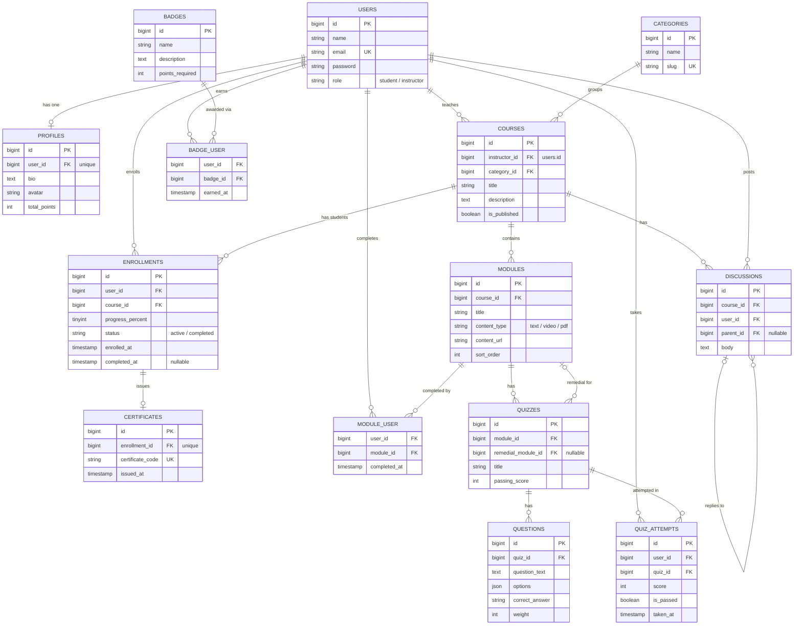

# Database Design: Entity Relationship Diagram

Sistem E-Learning Adaptif dengan Tracking Progress Belajar.

Gambar: [`erd.png`](./erd.png)

## 1. Entity Relationship Diagram

## 2. Ringkasan Relasi

| Jenis | Relasi | Eloquent |
| --- | --- | --- |
| One-to-One | `User` ↔ `Profile` | `hasOne` / `belongsTo` |
| One-to-One | `Enrollment` ↔ `Certificate` | `hasOne` / `belongsTo` |
| One-to-Many | `User` (pengajar) → `Course` | `hasMany` / `belongsTo` |
| One-to-Many | `Category` → `Course` | `hasMany` / `belongsTo` |
| One-to-Many | `Course` → `Module` | `hasMany` / `belongsTo` |
| One-to-Many | `Module` → `Quiz` | `hasMany` / `belongsTo` |
| One-to-Many | `Quiz` → `Question` | `hasMany` / `belongsTo` |
| One-to-Many | `User` / `Quiz` → `QuizAttempt` | `hasMany` / `belongsTo` |
| One-to-Many | `Course` / `User` → `Discussion` | `hasMany` / `belongsTo` |
| Self-referencing | `Discussion` → `Discussion` (balasan lewat `parent_id`) | `hasMany` / `belongsTo` |
| Many-to-Many + pivot data | `User` ↔ `Course` (pivot `enrollments`: `progress_percent`, `status`) | `belongsToMany` + `withPivot` |
| Many-to-Many + pivot data | `User` ↔ `Module` (pivot `module_user`: `completed_at`) | `belongsToMany` + `withPivot` |
| Many-to-Many + pivot data | `User` ↔ `Badge` (pivot `badge_user`: `earned_at`) | `belongsToMany` + `withPivot` |
| Has-Many-Through | `User` (pengajar) → `Module` melalui `Course` | `hasManyThrough` |

## 3. Catatan Desain

- **Adaptive learning (rule-based):** jika `quiz_attempts.score` < `quizzes.passing_score`, sistem merekomendasikan modul di `quizzes.remedial_module_id`.
- **Progress belajar:** `module_user` mencatat modul yang selesai; `enrollments.progress_percent` dihitung dari jumlah modul selesai dibanding total modul kursus.
- **Gamifikasi:** `profiles.total_points` bertambah dari aktivitas; `badges.points_required` menentukan kapan badge diberikan lewat `badge_user`.
- **Sertifikat:** satu `certificate` dibuat saat `enrollments.status` menjadi `completed`; PDF dibuat saat implementasi.
- **Unique constraint:** `users.email`, `profiles.user_id`, `categories.slug`, `certificates.enrollment_id`, `certificates.certificate_code`, dan pasangan (`enrollments.user_id`, `enrollments.course_id`).
- **Pilihan jawaban soal** disimpan sebagai kolom JSON `questions.options` agar jumlah tabel tetap ringkas.
